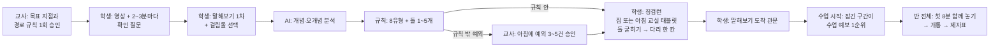

# 징검다리 총기획안 (v1.2 · 11/14 오전, 오늘 결정·3.5시간 개발 범위 반영)

팀 다이버 · 2026 INHA AX-EDU 해커톤 · 주제 3 (AI와 교육)

이 문서 하나로 "무엇을, 왜, 어떻게 만들고, 어떻게 발표하는지"를 정합니다. 바이브코딩할 때 AI 코딩 도구에게도 이 문서를 그대로 읽힙니다(저장소의 `docs/SPEC.md`로 복사).

세부 자료
- 게이미피케이션 규칙·화면·근거·예상 질문 전체: `docs/GAMIFICATION.md`
- 시연용 데이터 초안(25명 → 30명으로 늘려야 함): `data/class-2-3.json`(구현 때 만듦, 25명 초안은 환희가 가지고 있음)
- 팀 공유 페이지: 징검다리 최종 기획안 아티팩트

**v1.2에서 바뀐 것 (11/14 08:30)**
- 구간 개통 기준 80%, 함께 놓기 8분 규칙 확정 → 5-3 C2, 4장 표
- 나의 강 지도를 P1로 추가(정적 화면 1장) → 5-2 S8
- 공개 범위·환경 신호·외부 AI·보관 기간 추천안 → 10-1 (점심 회의에서 확정)
- 저장소에 코드가 아직 없어서, 개발 범위를 "시그니처 90초" 중심으로 다시 좁힘 → 11-4, 11-5
- 근거 2개 추가(80% 숙달 기준, 내재적 통합), 도입 로드맵(현장 적용), 멘토 질문 최신본 → 9-3, 17장
- (10:30) 학생·교실 화면에서 반·모둠·친구 숫자를 빼고 날씨로만 표현, 숫자는 교사만. 올해 레벨 제외 → 5-0
- (11:00) 얼굴로 학생 화면·시선을 보지 않기로 확정. 대신 **교사가 학생 개인 정보를 열 때 얼굴(또는 비밀번호) 재인증** → 5-1 T7, 5-6, 10

---

## 0. 한 장 요약

| 항목 | 내용 |
|---|---|
| 서비스 | **징검다리** — 플립러닝 사전학습 결손을 수업 전에 찾아 메우는 교사 지원 서비스 |
| 한 문장 | AI가 학생들의 "개념 말해보기" 답에서 막힌 곳을 찾고, 교사가 승인한 규칙에 따라 학생마다 다른 개수의 징검돌을 놓고, 반 전체가 함께 다리를 완성해 같은 수업에 도착하게 합니다. |
| 각인 문장 | **"다리가 끊긴 곳에서 수업이 시작된다"** / "같은 목적지, 다른 돌 개수" |
| 핵심 기능 4 | ① AI 학습 과정 분석과 수업 예보(교사) ② 8유형과 경로 설계(교사 승인) ③ 징검런(학생·교실) ④ 슈퍼패스 아침 체크인(교실 태블릿에서 QR·바코드·얼굴 중 선택) |
| 차별점 3 | 게임 판의 빈칸이 곧 수업 계획 / 얼굴은 학생을 보는 데 쓰지 않고, 학생 정보를 여는 교사를 확인하는 데 쓴다 / AI는 무대 뒤에서 교사를 돕고 학생에게 말을 걸지 않음 |
| 슈퍼스쿨 안에서 | 수업활동(자료·설문·성찰·과제) 안에 들어가고, 교사 홈에 수업 예보 카드, 슈퍼패스 운영 모드 "아침 징검다리" |
| 시연 단원 | 중2-1 국어(미래엔) 3. 국어의 체계와 소통 › 1. 음운 체계와 문자 체계 › 2. 국어의 문자 체계 |
| 시연 데이터 | 가상 학생 30명, 2학년 3반 |
| 기술 | Next.js + TypeScript + Tailwind, Vercel 배포, DB 없음(JSON + 브라우저 상태), LLM은 해커톤 AI 크레딧(BAZE API Gateway) |

---

## 1. 심사 기준 → 우리 전략

심사위원: 사범대·AI 분야 교수, 현직 교사, 산업체 전문가(슈퍼스쿨). 고득점 순.

| 항목 | 배점 | 심사 내용(공식) | 우리가 보여 줄 것 | 어디서 |
|---|---|---|---|---|
| 현장 문제 이해 | 20 | 실제 문제를 구체적으로 정의하고 원인을 분석했는가 | 팀11의 학원·교생 실습 경험, 2025 학업성취도 통계, 원인 3가지(안 봄·못 봄·봤는데 모름), "교사는 종이 울린 뒤에야 안다" | PPT 1장 |
| 해결 효과 | 15 | 교사·학생 등 교육 주체에게 줄 효과 | 교사: 30명 서술형 읽기 → 예보 30초. 학생: 수업 전 맞춤 돌, 하위권 혜택 근거. 4주 파일럿 지표 | PPT 5장 |
| 해결 방안 적절성 | 15 | 해결 방안이 문제에 적절하고 논리적인가 | 원인 3가지 ↔ 기능 3가지 1:1 대응, AI가 필요한 이유(30명 서술형), 규칙+AI 혼합, 규칙마다 학습 원리 | PPT 3장 |
| 현장 적용 가능성 | 15 | 도입 현실성과 확장성 | 교사 시간 표, 슈퍼스쿨 수업활동(자료·설문·성찰·과제)에 그대로 올라가는 구조, 슈퍼패스 운영 모드로 아침 교실 태블릿 체크인, 기기 없는 학생 종이 징검돌, 실제 수업에 쓰던 실험실 재사용, 다른 교과 확장(다리 = 개념 지도) | PPT 3·5장 |
| 윤리성·책임감 | 10 | 개인정보 보호, **저작권**, 교육 주체 간 **형평성** | 얼굴 이미지 미수신, 분리 동의, 가명, 학생부 미반영, 교사 최종 결정, 교과서 무단 사용 없음, 해례본은 공공 영역, 종이 징검돌, 미사용 불이익 0 | PPT 3·5장 |
| 독창성 | 10 | 기존 사례와의 차별성 | 다리 = 단원 개념 구조(제자표), 빈칸 = 수업 시작점, 순위 없는 경쟁 | PPT 1·3장, 시연 |
| 구체화 수준 | 10 | 활용 시나리오, 화면 설계, 프로토타입 | 실제로 동작하는 웹 데모(실험실 연동, 실시간 다리, 실제 AI 판정), AI 정확도 점검 결과, GitHub 코드 | 시연 |
| 발표 전달력 | 5 | 자료 구성, 전달력, 설득력, **팀원별 발표 기여도** | 진선우 메인 발표 + 4명 모두 역할이 보이게(아래 9장) | 발표 |

**놓치기 쉬운 두 가지**
1. 윤리성 항목에 **저작권**과 **형평성**이 명시돼 있어요. 개인정보만 말하면 점수가 빠져요. 9장에 한 줄씩 넣습니다.
2. 발표 전달력에 **팀원별 발표 기여도**가 있어요. 진선우 단독 발표로 가되, 시연 조작자 소개와 질의응답 분담으로 4명 모두 보이게 합니다. (팀 결정 필요)

---

## 2. 문제 정의

### 2-1. 현장 장면
플립러닝(거꾸로 수업)에서 학생은 수업 전에 영상으로 개념을 배우고, 교실에서는 그 개념으로 활동해요. 그런데 영상을 안 보고 온 학생은 수업 활동에 끼지 못하고, 영상과 본시 수업을 둘 다 놓쳐 결손이 쌓여요. 팀11(예비교사)은 학원과 교생 실습에서 이 장면을 매우 자주 봤어요.

### 2-2. 원인 3가지 → 기능 3가지
| 원인 | 지금 현장 | 징검다리 |
|---|---|---|
| ① 교사가 수업 전에 모른다 | 영상을 틀어 놓고 딴짓했는지, 어디서 막혔는지 종이 울린 뒤에야 안다. 30명의 서술형 답을 매일 읽을 시간이 없다 | **AI 학습 과정 분석 → 수업 예보**: 수업 전에 막힌 개념 TOP 3와 구간별 상태를 30초에 본다 |
| ② 학생마다 필요한 지원이 다르다 | 같은 보충 자료를 모두에게 주거나 아무것도 못 준다. 참여 문제인지, 선수 개념 문제인지, 환경 문제인지 구분할 근거가 없다 | **8유형 + 경로 설계**: 참여·능력·환경을 따로 읽어 학생마다 1~5개의 돌을 놓는다. 교사가 규칙을 승인한다 |
| ③ 사전학습을 할 이유를 못 느낀다 | 보상을 주면 화면만 켜 둔다. 순위를 매기면 하위권이 포기한다 | **징검런**: 확인된 학습만 진행으로 인정, 내 돌 하나가 반 다리 한 칸, 빈칸은 다음 날 반이 함께 메운다 |

### 2-3. 근거 (검증한 것만)
- 2025 국가수준 학업성취도 평가(한국교육과정평가원, 2026.6): 중3 '수업 준비 및 참여도' 높음 39.4%(전년 대비 2.3%p 하락, 유의), 수업 참여도 낮음 8.4%(1.1%p 상승, 유의). 중3 국어 학습의욕 높음: 3수준 이상 68.7% vs 1수준 45.3%.
- 영상 중간 퀴즈로 딴생각이 약 40%에서 20%로 줄었다(Szpunar 외 2013, PNAS).
- 수업 전 진단과 즉시 대응 구조는 무작위 실험에서 성취를 올렸고 하위권이 가장 큰 혜택을 봤다(Roschelle 외 2016, 43개교 약 2,850명).

---

## 3. 서비스 이용 타겟

| 대상 | 누구 | 쓰는 화면 | 얻는 것 |
|---|---|---|---|
| **1차 사용자: 교사** | 플립러닝·블렌디드 수업을 하는 중학교 교과 교사(시연: 중2 국어, 3개 반 90명 담당) | 수업 예보, 결재, 교실 다리 | 수업 전 30초에 시작점 결정, 서술형 30개를 직접 읽지 않아도 됨 |
| **2차 사용자: 학생** | 중학생 반 전체(특히 사전학습 결손 위험 학생) | 징검런 홈, 돌 굳히기, 말해보기 | 내게 맞는 크기의 돌, 혼자가 아니라 반이 함께 |
| **도입 주체: 학교** | 슈퍼스쿨을 쓰는 학교 | 슈퍼스쿨 수업활동 안의 메뉴, 슈퍼패스 교실 태블릿 | 새 플랫폼 없이 기존 수업활동·슈퍼패스 위에서 바로, 동의·보관 정책은 학교 기준 |

**페르소나 (시연용, 모두 가상)**
- 교사: 2학년 3반 국어 담당. 플립러닝 3주 차. "수업 들어가서 '영상 다 봤니?' 물어보면 조용해져요."
- 학생 옛이응 ㆁ (s07): 참여는 하는데 기본자 개념이 약하고, 학원 때문에 저녁 시간이 부족. 경로는 ㄴ(출발 돌) → ㄷ → ㅌ.
- 학생 s15: 이번 주 영상 미시작 2회(참여 신호 낮음), 집에 기기 없음. 작은 돌 1개 + 종이 징검돌 + 교사 안부 묻기.

---

## 4. 한 사이클 흐름



| 시점 | 누가 | 무엇을 | 시간 |
|---|---|---|---|
| 단원 시작 전 | 교사 | 목표 지점 정하기, 유형별 경로 규칙 승인 | 1회 5분 |
| 전날 15:00~ | 학생 | 영상 + 확인 질문 + 말해보기 1차 + 걸림돌 | 10~15분 |
| 제출 즉시 | AI + 규칙 | 분석 → 8유형 → 경로. 규칙 안이면 바로 열림 | 수 초 |
| 다음 날 아침 | 교사 | 예외 3~5건 확인·승인 | 3분 |
| 아침 07:50~08:40 | 기기·시간이 없는 학생 | 교실 태블릿에서 슈퍼패스 체크인(QR·바코드·얼굴 중 선택) → 그 태블릿에서 내 징검런 | 5~10분 |
| 수업 전까지 | 학생 | 징검런: 돌 1~5개 + 도착 관문 | 돌당 1~4분 |
| 수업 직전 | 교사 | 수업 예보 확인 | 30초 |
| 수업 첫 8분 | 반 전체 | 소나기 구간(놓인 돌 80% 미만) 함께 놓기 → 개통. 잠긴 구간이 없으면 생략 | 8분(교사가 5~10분 조정) |
| 수업 뒤 | 학생 | 밧줄 돌을 문항 2개로 굳히기 | 2분 |

---

## 5. 주요 기능 명세

우선순위: **P0** 시연에 반드시 나옴 · **P1** 있으면 좋음(시간 되면) · **P2** 로드맵 슬라이드로만

> 오늘 실제로 만드는 순서와 "정적 화면으로 충분한 것"은 11-5가 기준이에요. 아래 표의 P0 중 T3·S4는 로직 없이 정적 화면으로 먼저 만들어요.

### 5-0. 숫자는 교사만, 학생·교실 화면은 날씨로 (11/14 결정)
"25명 중 4명", "다섯 모둠 중 넷"처럼 반·모둠·친구의 숫자를 학생이 보는 화면에 띄우면, 남은 몇 명이 누구인지 찾게 되고 특정 학생을 솎아 내는 것처럼 보일 수 있어요. 그래서:
- **학생 화면·교실 화면**: 반·모둠·친구에 대한 숫자를 쓰지 않아요. 구간과 반의 상태는 **날씨**로만 말해요. 맑음(다 이어짐) · 구름(거의 이어짐) · 소나기(함께 놓을 곳). 날씨를 정하는 기준(100% / 80~99% / 80% 미만)은 화면에 쓰지 않아요.
- 다리 그림은 구간별 물높이와 돌 모양으로만 보여 주고, 칸 수·깃발 수 글자는 없어요.
- **본인 숫자는 괜찮아요**: 내 진행 링(2/3), "1칸 남음 · 4분이면 완주", '지난 3번의 나'는 본인만 봐요.
- **교사 화면**: 구간별 놓인 돌(예: 병서 17/26), 오개념 인원, 예외 건수, 함께 놓기 정답 모둠 수 같은 정확한 숫자는 교사만 봐요.
- 진행도는 오늘 링 + 단원 별(★ 굳힘 · ★★ 설명 · ★★★ 일주일 뒤에도)까지만, 본인만 봐요. **올해 레벨은 넣지 않아요**(쌓이는 레벨은 점수처럼 읽혀 "점수 없음" 원칙과 부딪힘).

### 5-1. 교사
| ID | 기능 | 내용 | 우선 |
|---|---|---|---|
| T1 | 수업 예보 | 헤더(3교시 10:50 · 수업까지 12분), 구간 날씨 카드 3개(상형·가획·병서), 막힌 지점 TOP 3(오개념 단위, 인원), 유형 분포, 예외 n건, [함께 놓기 시작]. 모든 AI 결과에 "꼭 교사 본인이 직접 확인하시길 바랍니다" | P0 |
| T2 | AI 분석 실행 | [AI 분석] 버튼 → 30명 말해보기 분석(실제 LLM, 실패 시 저장된 결과) → 예보 갱신. "AI 판정과 예비교사 판정 일치 N/30" 표시 | P0 |
| T3 | 결재(예외 승인) | 규칙 승인 요약 + 예외 탭(번호순), 학생별 근거 1줄, 경로 돌 빼기/더하기, [승인] → 붉은 승인 도장 + 기록(누가·언제·몇 건·몇 건 수정). 얼굴 서명은 특강에서 가능하다고 확인되면 선택 기능 | P0 |
| T4 | 학생 상세 | 말해보기 원문, AI가 찾은 개념·오개념과 근거 구절, 참여 사건, 걸림돌(교사만). T7 잠금을 거쳐야 열림 | P1 |
| T5 | 로그인 | 슈퍼스쿨 교사 계정 그대로(징검다리는 슈퍼스쿨 안의 메뉴) | P2(설명만) |
| T6 | 목표 지점·규칙 설정 | 목표 문장, 유형별 돌 세트 표 | P2(슬라이드) |
| T7 | 학생 정보 잠금 | 반 단위 집계(구간 날씨·숫자, 오개념 TOP 3 인원)는 로그인만으로 보이지만, **특정 학생이 드러나는 정보**(이름이 붙은 목록, 말해보기 원문, 근거 구절, 참여 사건, 걸림돌, 예외 근거)는 흐리게 잠겨 있다. [학생 정보 보기 · 얼굴 1초] 또는 [비밀번호]로 열고(같은 효력), 10분 뒤나 화면을 떠나면 다시 잠긴다. 열람 기록 {누가, 언제, 어느 학생, 무엇을, 방법}을 남기고 교사가 "내 열람 기록"에서 본다. 시연은 모의 인증 | P0(모의) |

### 5-2. 학생
| ID | 기능 | 내용 | 우선 |
|---|---|---|---|
| S1 | 징검런 홈 | 진행 링(출발 돌 켜진 채 시작), "1칸 남음 · 4분이면 완주 🏁", 돌 목록, [오늘은 여기까지], "지금 친구들도 함께 건너는 중"(숫자 없음, 아무도 없으면 숨김), 진행도는 오늘 링 + 단원 별까지(올해 레벨 없음), "성적·학생부에 들어가지 않아요" | P0 |
| S2 | 돌 굳히기 | 개념 카드 1줄 → 실험실 iframe(목표 글자 만들기) → 굳히기 2문항 → 틀리면 교정 설명 + 변형 1문항 → "첨벙! 한 칸 놓음" | P0 |
| S3 | 말해보기 도착 관문 | 문장 틀 → 판정(키워드 → AI) → 통과 시 해례 원문 「聲出稍厲 故加畫」 + "세종이랑 같은 답 씀 ㄷㄷ" + 칭호 승급 | P0 |
| S4 | 아침 교실 태블릿 체크인 | 슈퍼패스 운영 모드 "아침 징검다리"(교실 태블릿, 키오스크 화면). [QR] [바코드] [얼굴] 중 골라 1초 인증 → 그 태블릿에서 내 징검런이 열림 → 끝나면 자동 로그아웃. 징검다리는 "본인 맞음 · 방법 · 장소 · 시각"만 받음. [무엇이 어디로 가나요?] 투명성 카드. 어떤 방법이든 결과는 같음 | P0 |
| S5 | 첫 수업 안내·동의 | 카드 3장 + 분리 동의(서비스 이용 / 얼굴 인증은 따로·선택) | P1 |
| S6 | 영상 확인 질문 | 영상 구간 위에 질문 오버레이, 즉시 교정, 말해보기 1차 + 걸림돌 | P1(안 되면 슬라이드 정지 화면 2장) |
| S7 | SOS | 2번 막히면 익명 구조 신호 → 준비된 구조 카드 | P2(슬라이드) |
| S8 | 나의 강 지도 | 단원마다 개통한 반 다리(제자표)를 한 장씩 모은 개인 지도. 숙달한 개념만 남기고 점수·순위·날짜 연속은 없음. 학년도 말까지 보관, 내려받기 가능. 정적 화면 1장(이번 단원 + 다음 단원 "아직 물속") | P1 |

### 5-3. 교실 화면(프로젝터)
| ID | 기능 | 내용 | 우선 |
|---|---|---|---|
| C1 | 우리 반 다리 | 구간 3개를 날씨로(상형 맑음 · 가획 구름 · 병서 먹구름), 이름·모둠 줄·칸 수·깃발 수 없음. 학생이 돌을 놓으면 실시간 "첨벙", 물높이가 조금 내려감 | P0 |
| C2 | 수업 시작 | 물때에 구간별 놓인 돌 비율로 날씨를 정함: 100% 맑음 / 80~99% 구름(개통, 남은 돌은 밧줄 돌로 그날 안에) / 80% 미만 소나기(잠기며 반짝임). 예보가 "병서 소나기 · 첫 8분 함께 놓기"로 바뀜. 함께 놓기 8분: 잠긴 구간 1개면 O/X 2문항, 2개면 구간마다 1문항, 3개면 8분 + "본시 진도 조정 권장" 알림, 0개면 생략. 교사는 기준을 바꾸거나 구간을 직접 잠글 수 있음 | P0 |
| C3 | 함께 놓기 | O/X 큰 문항, 30초 상의 → 결과는 날씨로만("구름이 걷혔어요"), 정답 모둠 수는 교사 화면에만, 잠긴 돌이 밧줄에 묶여 떠오름 | P0 |
| C4 | 개통과 제자표 | 배너 → 위에서 보기 → 돌이 자음 제자표로 정렬(크로스페이드부터) | P0 |

### 5-4. 시연 전용
| ID | 기능 | 우선 |
|---|---|---|
| D1 | `/demo` 화면 전환(1 학생 · 2 교실 · 3 교사), 단축키 R 리셋 · N 다음 · T 수업 시작 · A 승인 · O 오프라인 강제, 첨벙 장면만 좌우 분할 | P0 |
| D2 | 우하단 작은 표시 "시연용 가상 학생 데이터 · 모의 인증" | P0 |

### 5-5. 만들지 않는 것 (로드맵 슬라이드 한 줄)
세종 튜터 대화, 집중 거울, 순위·연속 기록, 실제 슈퍼패스 연동(시연은 모의), 학생 "내가 직접 했어요" 도장(태블릿 체크인으로 대체), 심사위원 QR 참여, 모음 다리, 반 대 반 시즌전.

### 5-6. 슈퍼스쿨 안에서 동작하는 방식
팀 계정(연습용 학교 "인하대체험 해커톤11")에서 실제 메뉴를 확인하고 맞췄어요.

| 슈퍼스쿨 기능 | 지금 하는 일 | 징검다리가 붙는 방식 |
|---|---|---|
| **수업활동**: 수업 → 묶음(단원) → 활동(자료·과제·설문·공지·성찰) | 활동을 올리고 누가 냈는지(제출률, 미제출 알림, 학생별 현황)를 본다 | 사전학습 영상 = **자료**, 영상 확인 질문 = **설문**, 개념 말해보기 = **성찰**, 징검돌 = 학생별 **과제**. 징검다리는 이 제출 기록을 읽어 **무엇을 모르는지**와 **내일 수업 시작점**을 만든다 |
| **교사 홈**(처리할 업무, 메모, 일정) | 출결 이상, 미처리 문서, 안 읽은 메시지 | 홈에 **"오늘의 수업 예보"** 카드 1장(막힌 지점 TOP 3, 예외 n건) |
| **슈퍼패스**(학교 태블릿 + QR·바코드·페이스패스, 급식·선착순·출석 템플릿) | 교문 등교 체크, 야자 출석, 선착순 행사 | ① 교사: **학생 정보를 열 때 얼굴 1초 재인증**(T7, 비밀번호로 대체 가능) ② 학생: 운영 모드 **"아침 징검다리"**(출석 모드 응용, 월~금 07:50~08:40, 교실 태블릿). 체크인하면 그 태블릿에서 내 징검런이 열린다 |
| 생기부 초안 생성, 학생별 AI 종합 분석 | 활동 기록으로 생기부 문장 초안 | **연결하지 않는다.** 징검다리는 수업 전 진단 도구이고 학생부에 반영하지 않는다 |
| 성장 마일리지(학생별 플러스·마이너스 점수) | 행동에 점수 | **연결하지 않는다.** 징검런은 점수가 아니라 숙달한 개념을 모은다(과잉정당화 방지) |

- 발표 한 줄: **"슈퍼스쿨은 누가 냈는지를 보여 줍니다. 징검다리는 무엇을 모르는지, 그래서 내일 수업을 어디서 시작할지를 보여 줍니다."**
- 페이스패스를 태블릿 체크인에 쓰는 이유: 슈퍼패스가 원래 학교 태블릿에서 QR·바코드·얼굴로 출입을 기록하는 제품이라 그대로 쓴다. QR·바코드가 처음부터 대체수단이라 선택권이 자연스럽고, 집에 기기가 없는 학생이 학교에서 돌을 놓는 형평성 장치가 된다. 학생 이득은 "공용 태블릿에서 아이디·비밀번호 없이 1초 만에 내 징검런 열기" 하나.
- 얼굴 정보는 슈퍼패스(토스) 쪽에서 처리한다(토스 공식 Q&A: 암호화해 토스 서버에 보관). 징검다리에는 오지 않는다. "기기 안에서 처리"라고 말하지 않는다.
- PPT용 캡처(선택): 팀 연습용 학교에 "중2 국어 · 문자 체계" 수업을 만들고 묶음 안에 자료·설문·성찰 활동을 넣어 캡처한다. 계정에 내용을 만드는 일이라 팀이 직접 하거나 맡길 때만 한다.

---

## 6. AI 설계 (AI 교수 심사위원이 가장 먼저 볼 곳)

### 6-1. 원칙: 판단은 규칙과 교사, AI는 "읽기"만
| 일 | 누가 | 이유 |
|---|---|---|
| 말해보기 답에서 개념·오개념 찾기 | **AI(LLM)** | 30명의 서술형은 교사 혼자 매일 읽을 수 없다. 표현이 제각각이라 키워드만으로는 놓친다 |
| 8유형 계산 | 규칙 | 설명 가능해야 한다. "왜 이 유형?"에 근거 3줄로 답할 수 있어야 한다 |
| 경로(돌 고르기) | 규칙(교사가 승인한 돌 세트) | AI가 혼자 정하는 길은 없다. 인공지능기본법은 초·중등 학생 평가를 고영향 AI로 보고 사람의 관리·감독을 요구한다 |
| 수업 예보 집계 | 규칙 | 숫자는 정확해야 한다 |
| 도착 관문 판정 | 키워드 먼저, 애매하면 AI, 최종은 교사 덮어쓰기 | 빠르고 싸고, 틀려도 교사가 고친다 |

발표 문장: "AI는 30명의 답을 읽고, 규칙은 길을 고르고, 선생님이 승인합니다."

### 6-2. AI-1 말해보기 분석
- 입력: 단원 개념 목록(C1~C6), 오개념 목록(M1~M7), 학생 답 1개(가명 ID만)
- 출력(JSON 고정):
```json
{ "concepts_hit": ["C2"], "misconceptions": ["M1"], "evidence": "ㄲ도 ㄱ에 획을 더한 거", "confidence": 0.82, "needs_teacher": false }
```
- 시스템 프롬프트(초안):
```
너는 중학교 국어 교사를 돕는 분석 도우미다.
학생이 쓴 "오늘 배운 개념 말해보기" 답을 읽고, 주어진 개념 목록과 오개념 목록에 비추어 무엇을 이해했고 무엇을 오해했는지만 판단한다.
학생의 성격, 태도, 의욕은 추측하지 않는다. 목록에 없는 개념이나 오개념을 만들어 내지 않는다.
근거는 학생 답에서 그대로 인용한다. 확신이 낮으면 confidence를 0.5 미만으로 두고 needs_teacher를 true로 한다.
반드시 지정된 JSON 형식으로만 답한다.
```
- 개념 목록(진선우 확정): C1 기본자 5개는 발음 기관을 본떴다(상형) · C2 가획은 기본자에 획을 더한다 · C3 획을 더하면 소리가 세진다 · C4 병서는 같은 글자를 나란히 쓴다 · C5 이체자(ㆁ ㄹ ㅿ)는 가획과 다르다 · C6 자음은 발음 기관, 모음은 천지인
- 오개념 목록(아이디어 노트 그대로): M1 ㄲ도 가획이다 · M2 세기 = 크기 · M3 ㅋ과 ㄲ은 같은 원리 · M4 ㄷ도 기본자 · M5 ㅏ→ㅑ도 가획 · M6 자음도 자연물을 본떴다 · M7 ㅇ은 소리 없는 글자라 기본자가 아니다

### 6-3. AI-2 도착 관문 판정
- 단계 1 키워드 루브릭(서버, 0.01초): 핵심 생각 2개 각각의 필수 낱말 묶음(예: 생각1 = {획, 더} , 생각2 = {세, 거세, 소리}) → 2/2면 통과
- 단계 2 AI(키워드 실패 시만, 4초 제한): `{ "ideas":[{"id":"I1","hit":true,"quote":"..."}], "misconception": "M2"|null, "feedback": "한 문장, 칭찬 먼저" }`
- 단계 3 실패·시간 초과: "선생님이 확인할게요"로 저장(통과 처리 안 함)

### 6-4. 안전장치
1. 외부로 보내는 건 가명 ID와 답 텍스트뿐. 보내기 전에 숫자·전화번호·이메일 패턴을 가린다.
2. 위기 낱말(예: 죽고 싶, 자해, 맞았)이 보이면 AI에 보내지 않고 교사 화면에 "확인 필요"만 띄운다.
3. 온도 0, JSON 형식 강제, 형식 검사 실패 시 1회 재시도 후 대체 결과.
4. 모든 AI 결과에 출처 표시(`source: "llm" | "keyword" | "saved"`)와 교사 확인 알림.

### 6-5. AI 정확도 점검 (구체화 수준 + AI 교수 포인트)
- 진선우·김나희가 30명 답을 쓸 때 **의도한 오개념을 정답 라벨로 함께 적는다**(이미 쓰는 거라 추가 작업 거의 없음).
- 내일 오전 스크립트로 30개를 한 번에 분석 → 라벨과 비교 → "오개념 탐지 일치 N/30, 놓친 것 k개는 교사 확인으로 넘어감"을 교사 화면과 PPT에 표시.
- 정직하게 말한다: "가상 답 30개로 한 점검이라 실제 정확도는 파일럿에서 다시 잰다."

---

## 7. 기술 설계 (바이브코딩용)

### 7-1. 구성
```
[브라우저: 학생 탭 / 교실 탭 / 교사 탭]
   │  같은 브라우저 안에서 BroadcastChannel로 실시간 동기화
   │  상태는 localStorage('jingum:v3')에 저장
   ▼
[Next.js 서버 (Vercel)]  app/api/*  ← 여기가 "백엔드"
   │  ① API 키 보관  ② LLM 호출  ③ 규칙 계산  ④ 모의 슈퍼패스 체크인
   ▼
[BAZE API Gateway (안뇽GPT, OpenAI 호환)]
```
- **DB를 쓰지 않는 이유**: 시연은 한 노트북에서 돌아가고, Vercel 서버는 요청마다 새로 떠서 상태를 기억하지 못한다. 그래서 시연 상태는 브라우저에 두고, 서버는 계산과 AI 호출만 한다. 실제 도입 때는 슈퍼스쿨 DB를 쓴다고 말한다.
- **실험실**: 팀원 사이트를 수정 없이 `public/lab/`에 복사해 같은 주소에서 iframe으로 띄운다(같은 출처여야 완성 여부를 읽을 수 있다). README에 원작자와 출처를 적는다.

### 7-2. 폴더 구조
```
app/
  page.tsx                    시작 화면(교사 / 학생 / 교실 / 시연)
  teacher/page.tsx            T1 수업 예보 + T2 AI 분석
  teacher/approve/page.tsx    T3 결재
  student/page.tsx            S1 징검런 홈 (?id=s07)
  student/stone/[id]/page.tsx S2 돌 굳히기
  student/explain/page.tsx    S3 도착 관문
  student/welcome/page.tsx    S5 안내·동의 (P1)
  class/page.tsx              C1~C4 교실 다리
  checkin/page.tsx            S4 아침 교실 태블릿 체크인(키오스크 화면)
  demo/page.tsx               D1 시연 컨트롤
  api/analyze/route.ts        AI-1
  api/explain/route.ts        AI-2
  api/plan/route.ts           8유형 + 경로 + 예보 (규칙)
  api/checkin/route.ts        모의 슈퍼패스 체크인 (결과만 돌려줌)
lib/
  types.ts                    모든 타입 (같이 씀: 기존 이름은 지우지 말고 추가만)
  store.ts                    useDemo(): 상태 + localStorage + BroadcastChannel + 장면 단계
  rules/classify.ts           8유형
  rules/path.ts               돌 고르기
  rules/forecast.ts           예보 집계
  rules/bridge.ts             다리 칸 계산
  rules/judge.ts              굳히기·키워드 판정
  llm.ts                      LLM 호출(타임아웃·재시도·JSON 검사)
  prompts.ts                  프롬프트
data/
  class-2-3.json              학생 30명(가명, 신호, 말해보기 답, 정답 라벨)
  stones.json                 돌 카드와 굳히기 문항
  concepts.json               개념 C1~C6, 오개념 M1~M7, 해례 원문
  analysis.saved.json         AI 분석 저장본(대체 결과)
public/lab/                   실험실 사본
docs/SPEC.md                  이 문서
CLAUDE.md                     AI 코딩 규칙 (아래 11-2)
```

### 7-3. 핵심 타입 (lib/types.ts 초안)
```ts
export type Section = "상형" | "가획" | "병서";
export type Barrier = "기기 없음" | "인터넷 없음" | "시간 부족" | "집에서 하기 어려워요" | "내용이 어려움";

export interface Student {
  id: string;            // "s07"
  no: number;            // 7
  name: string;          // 교사 화면 전용 가짜 실명
  alias: string;         // "옛이응 ㆁ" (학생·AI에 쓰는 가명)
  team: 1 | 2 | 3 | 4 | 5;
  signals: {
    videoStarted: boolean;
    checkFirstTry: Record<string, boolean>; // 개념ID → 영상 질문 첫 시도 정답
    explain1: string;                       // 말해보기 1차
    explainSubmitted: boolean;
    barriers: Barrier[];
  };
  label?: { misconceptions: string[] };     // 정확도 점검용 정답 라벨
}

export interface Analysis {
  studentId: string;
  conceptsHit: string[];
  misconceptions: string[];
  evidence: string;
  confidence: number;
  needsTeacher: boolean;
  source: "llm" | "keyword" | "saved";
}

export interface TypeResult {
  studentId: string;
  participation: "있음" | "낮음";
  readiness: "준비" | "보충";
  environment: "양호" | "걸림돌";
  reasons: string[];       // 교사에게 보여 줄 관찰 사건
}

export interface PathPlan {
  studentId: string;
  stones: { stoneId: string; start: boolean; why: string }[];
  approval: "rule" | "exception";
  approved: boolean;
}

export interface Stone {
  id: string;              // "st-ㅌ"
  char: string;            // "ㅌ"
  section: Section;
  kind: "lab" | "card" | "small";
  minutes: 1 | 2 | 4;
  concepts: string[];
  questions: Question[];   // 2개 + 변형 1개
}

export interface Question { id: string; prompt: string; options: string[]; answer: number; explain: string; }

export type DemoEvent =
  | { type: "stone_placed"; studentId: string; stoneId: string; at: string }
  | { type: "explain_passed"; studentId: string; at: string }
  | { type: "sos"; studentId: string; stoneId: string; at: string }
  | { type: "approved"; who: "teacher"; count: number; at: string }
  | { type: "checked_in"; studentId: string; method: "qr" | "barcode" | "face"; place: string; at: string }
  | { type: "class_started"; at: string }
  | { type: "together_done"; correctTeams: number; at: string }
  | { type: "opened"; at: string };

export interface DemoState { step: 0 | 1 | 2 | 3 | 4 | 5 | 6; now: string; events: DemoEvent[]; }
```

### 7-4. API 명세
| API | 요청 | 응답 | 실패 시 |
|---|---|---|---|
| `POST /api/analyze` | `{ answers: [{ studentId, text }] }` | `{ results: Analysis[], agreement?: { matched, total } }` | 저장본(`source:"saved"`) |
| `POST /api/explain` | `{ studentId, stoneId, text }` | `{ passed, ideas:[{id,hit,quote}], misconception, feedback, source }` | `{ passed:false, feedback:"선생님이 확인할게요", source:"saved" }` |
| `POST /api/plan` | `{ analyses?: Analysis[] }` (없으면 저장본) | `{ types: TypeResult[], paths: PathPlan[], forecast }` | 없음(순수 계산) |
| `POST /api/checkin` | `{ studentId, method: "qr"\|"barcode"\|"face", place }` | `{ verified: true, method, place, at }` — 이미지·특징값 필드 없음(실제로는 슈퍼패스가 인증하고 결과만 넘겨 줌) | `{ verified:false }` → 다른 방법(QR·바코드) 안내 |

`forecast` 형식:
```json
{ "sections": [ { "name": "병서", "placed": 17, "total": 26, "weather": "소나기" } ],
  "top": [ { "misconception": "M1", "text": "ㄲ도 획을 더한 글자", "count": 8 } ],
  "types": { "있음·준비·양호": 8, "...": 0 },
  "exceptions": 3, "flags": 20, "students": 30, "crossingNow": 7 }
```

### 7-5. 상태와 시연 단계 (lib/store.ts)
| 단계 | 이름 | 교실 화면 | 학생 화면 | 교사 화면 |
|---|---|---|---|---|
| 0 | 초기 | 상형 맑음 · 가획 구름 · 병서 먹구름, 수업까지 12분 | 링 2/3, "1칸 남음" | 예보 + 숫자(가획 37/38 · 병서 17/26) |
| 1 | ㅌ 첨벙 | 가획 구름 → 맑음 | 링 3/3 → 도착 관문 열림 | 가획 38/38 "맑음" |
| 2 | 말해보기 통과 | 깃발 하나 꽂힘(숫자 없음) | 해례 원문, 칭호 승급 | 도착 21/30 |
| 3 | 수업 시작 | 80% 미만인 병서 구간 잠김, 잠긴 돌 9개 반짝 | - | "병서 소나기 · 첫 8분 함께 놓기" |
| 4 | 함께 놓기 | O/X → "구름이 걷혔어요" → 밧줄 | - | 정답 모둠 4/5 |
| 5 | 개통 | 세 구간 모두 맑음, 배너 | - | 78/78 |
| 6 | 제자표 | 위에서 보기 → 제자표 | 나의 강 지도에 한 장 추가(P1) | - |

- 모든 시각은 가상 시계 `now = "2026-11-14T10:38:00+09:00"` 기준. 실제 시각을 쓰면 오후 발표 때 수업이 이미 지난 것처럼 보인다.
- 숫자는 30명 데이터로 계산한 값으로 바꾼다(위 숫자는 예시).

### 7-6. 실험실 연동 요점
- sessionStorage `hg-class` = `{"role":"solo"}`, 주소 해시 `#consonant`
- 500ms마다 `iframe.contentWindow.__lab.snapshot().c.made`에 목표 글자가 생겼는지 확인
- 리셋 때 지울 키: `hg-cons`, `hg-cons-ach`, `hg-cons-tries`, `hg-cons-solved`, `hg-cards-gate`
- 실험실 승급 화면이 우리 칭호와 겹치면 iframe 안에 스타일을 넣어 숨김
- 시연 전에 ㄷ이 이미 만들어진 상태로 준비해 획 1번만 끌게 함. 실패 대비 숨은 키 `K` = 완성 처리

---

## 8. 데이터 명세 (예비교사 작업)

### 8-1. 학생 30명 구성 (김나희)
| 유형(참여·능력·환경) | 인원 | 경로 돌 수 | 예시 |
|---|---|---|---|
| 있음·준비·양호 | 8 | 1 (심화) | 또래 튜터 희망 2명 |
| 있음·보충·양호 | 7 | 3 | s07 옛이응(경로 ㄴ→ㄷ→ㅌ) |
| 있음·준비·걸림돌 | 3 | 1 | 시간 부족 |
| 있음·보충·걸림돌 | 4 | 2~3 | 기기 없음 → 종이 징검돌 |
| 낮음·준비·양호 | 2 | 작은 돌 2 | |
| 낮음·보충·양호 | 3 | 작은 돌 2 | |
| 낮음·준비·걸림돌 | 1 | 작은 돌 1 | |
| 낮음·보충·걸림돌 | 2 | 작은 돌 1 | s15 |

- 가명은 지금은 안 쓰는 훈민정음 글자나 중립적인 낱말로, 약함·반쪽으로 들리는 이름은 뺀다.

#### 8-1-1. 8유형 기본 개입 (팀 시안 `docs/design/student-types-octant.html` 반영, 교사 화면 전용)
축 이름은 화면에서 **참여 신호 · 선수 개념(준비/보충) · 환경(양호/걸림돌)**으로 쓴다(시안의 '의욕', '기초'를 바꿔 부름). 이 표와 3D 좌표 그림은 교사 화면과 발표에만 쓰고, 학생·교실 화면에는 유형을 드러내지 않는다.

| 참여 | 선수 개념 | 환경 | 기본 개입 |
|---|---|---|---|
| 있음 | 준비 | 양호 | 심화 돌, 또래 설명 역할(희망자) |
| 있음 | 보충 | 양호 | 선수 개념 돌 추가, 소그룹 지도 |
| 낮음 | 준비 | 양호 | 선택권 주기, 도전 돌, 동기 탐색 대화(안부 묻기) |
| 낮음 | 보충 | 양호 | 짧은 목표(작은 돌), 흥미 연결, 1:1 대화 |
| 있음 | 준비 | 걸림돌 | 종이 돌·교내 시간대(아침 태블릿)로 기회 보장 |
| 있음 | 보충 | 걸림돌 | 환경 지원(기기 대여, 교내 학습 공간)을 먼저 하고 보충 |
| 낮아 보임 | 준비 | 걸림돌 | **환경을 먼저 해소한 뒤 참여를 다시 판단**, 그다음 도전 돌 |
| 낮아 보임 | 보충 | 걸림돌 | **환경 때문일 수 있음.** 환경을 해소한 뒤 참여 문제인지 다시 판단 |

- 규칙: 환경 걸림돌이 있으면 참여 신호를 "낮음"으로 확정하지 않고 "낮아 보임"으로 두고 판단을 미룬다(GAMIFICATION 3-3 "걸림돌을 골랐으면 판정하지 않음"과 같은 원칙).
- 모둠 5개(소리 갈래: 어금닛·혓·입술·잇·목구멍), 모둠당 6명.

### 8-2. 말해보기 답 30개 (진선우)
- 오개념 분포 목표: M1 8명, M2 6명, M4 4명, M3 3명, 나머지 M5·M6·M7 각 1~2명, 오개념 없음 8명 이상
- 각 답에 **정답 라벨**(의도한 오개념 ID)을 적는다 → AI 정확도 점검에 씀
- 중학생 말투, 1~3문장, 맞춤법 실수 조금

### 8-3. 돌 카드와 문항 (진선우)
- 시연 경로 우선: ㄴ(상형), ㄷ·ㅌ(가획), ㄲ(병서) 돌
- 각 돌: 개념 카드 1줄 + 굳히기 2문항 + 변형 1문항(정답, 한 줄 해설)
- 문항은 해례 표현 「聲出稍厲」(소리가 조금 세짐) 기준. 현대 '거센소리'와 섞지 않는다(ㄴ→ㄷ은 거센소리화가 아님)
- 함께 놓기 문항: "ㄲ은 ㄱ에 획을 하나 더한 글자다 (O/X)" + 예비 1문항
- 도착 관문: 질문, 문장 틀 3단계, 핵심 생각 2개와 키워드

---

## 9. 시연과 발표

### 9-1. PPT 구성 (공식 순서 그대로, 5분)
| 공식 순서 | 시간 | 슬라이드 | 핵심 대사 |
|---|---|---|---|
| 0. 표지 | 0:00–0:05 | 징검다리 · 팀 다이버 · 4명(3개 학과) | "다이버, 현장 문제에 뛰어든 세 학과입니다." |
| 1. 문제 인식 및 아이디어 구체화 | 0:05–0:55 | ① "영상 다 보고 온 사람?" ② 통계 ③ 원인 3가지 ④ 다리 정지 화면 + 각인 문장 | "선생님은 종이 울린 뒤에야 압니다. 징검다리에서는 12분 전에 압니다." |
| 2. 서비스 이용 타겟 | 0:55–1:10 | 교사·학생·학교 3칸 | "쓰는 사람은 선생님, 건너는 사람은 반 전체입니다." |
| 3. 주요 기능 | 1:10–1:55 | 기능 4개(각 1장면) + 원인↔기능 대응 + "AI는 읽고, 규칙은 고르고, 선생님이 승인" | |
| 4. 시연 | 1:55–3:25 | 라이브 90초 (9-2) | "다리가 끊긴 곳에서, 수업이 시작됩니다." |
| 5. 기대효과 | 3:25–4:35 | 교사 시간 표, 규칙=학습 원리 표, 윤리·저작권·형평성 3줄, AI 정확도 N/30, 4주 파일럿 지표, 확장(다른 교과) | "얼굴 인증이 성적을 올린다는 연구는 없습니다. 성적을 올리는 건 수업 전에 막힌 곳을 아는 겁니다." |
| 6. Q&A | 4:35–5:00 | 마무리 문장 + 팀원 4명 | "아무도 혼자 건너지 않는 다리입니다." |

**팀원별 발표 기여도 (팀 결정 필요)**: 진선우 메인 발표는 그대로 두고, ① 시연 시작 때 "시연은 신재우·정환희가 조작합니다" 한 줄 소개, ② 질의응답 분담(교육·현장 김나희·진선우, AI·데이터 정환희, 화면·구현 신재우)을 발표 끝 슬라이드에 이름과 함께 띄우는 것을 추천.

### 9-2. 라이브 시연 90초
| 초 | 화면 | 조작 | 대사 |
|---|---|---|---|
| 0–8 | 교실 다리(전체 화면) | 단축키 2 | "2학년 3반 다리입니다. 수업까지 12분, 상형은 맑고 가획은 구름, 병서에는 먹구름이 끼어 있어요. 몇 명이 남았는지는 교실 화면에 나오지 않습니다. 숫자는 선생님 화면에만 있어요." |
| 8–28 | 학생 폰 + 교실(분할) | 실험실에서 ㄷ에 획 1번 → 문항 2개 | "옛이응 학생이 마지막 돌 ㅌ을 굳힙니다." → 첨벙 |
| 28–43 | 학생 도착 관문 | 문장 입력(미리 준비) → 판정 | "자기 말로 설명하면… 580년 전 해례본과 같은 설명이네요." |
| 43–58 | 교실 + 교사 예보 | 단축키 T | "수업 시작. 병서 구간에 소나기가 내려 다리가 잠겼습니다. 예보가 '첫 8분은 함께 놓기'로 바뀝니다." |
| 58–78 | 교실 함께 놓기 | 심사위원 답 받아 클릭 | "심사위원님, ㄲ은 ㄱ에 획을 하나 더한 글자다, O일까요 X일까요?" → 밧줄 → 개통 |
| 78–90 | 제자표 | 단축키 N | "다섯 모둠이 한 줄씩 놓았는데, 모으니 훈민정음 자음 설계도입니다." |

- O가 나오면: "바로 이겁니다. 우리 반에도 O를 고른 학생이 꽤 있었어요(정확한 인원은 선생님 화면에만). 그래서 오늘 수업이 여기서 시작합니다."
- 슈퍼패스 아침 체크인은 주요 기능(3장)에서 5초 라이브 또는 캡처: 집에 기기가 없는 학생이 교실 태블릿에서 [얼굴]을 골라 1초 → "오늘 돌 1개 · 1분이면 완주" 징검런이 열림. "QR·바코드를 골라도 똑같습니다."
- 실패 대비: 각 단계 단축키 N으로 강제 진행, 90초 녹화본을 다른 탭에 열어 둠, 와이파이 없으면 노트북에서 `npm run build && npm start`로 실행.

### 9-3. 기대효과 표 (PPT 5장)
| 대상 | 지금 | 징검다리 |
|---|---|---|
| 교사 | 서술형 30개 읽기 불가, 종이 울린 뒤에 파악 | 예보 30초 · 예외 승인 3분 · 함께 놓기 8분 |
| 결손 위험 학생 | 같은 보충 또는 방치, 순위에서 포기 | 내 크기의 돌, 깃발은 누구나 1개, 빈칸은 반이 함께 |
| 반 전체 | 수업이 결손 학생 때문에 멈춤 | 모두 같은 본시 수업에 도착 |
| 학교 | 새 플랫폼 부담 | 슈퍼스쿨 안에서, 학교 동의 정책 그대로 |

4주 파일럿 지표: 수업 전 도착률, 굳히기 첫 시도 정답률, 본시 형성평가 사전·사후, 교사 준비 시간.

도입 로드맵 (현장 적용 15점, 팀11 제안 반영)
1. 1학기: 한 학년 한 교과, 4주(1단원) 파일럿 → 위 지표 확인
2. 도입 첫해: 학습 원리 연구를 근거로 학생·학부모 설명회
3. 이듬해부터: 우리 학교 전년도 결과(도착률, 형성평가 변화)로 설명
- 얼굴 인증은 입학 절차와 묶지 않아요. 입학 때 안내는 "쓰게 하기"가 아니라 "알고 고르게 하기"예요(묶으면 사실상 강제로 볼 수 있음, GAMIFICATION 4-4).

---

## 10. 윤리·저작권·형평성

| 구분 | 내용 |
|---|---|
| 개인정보 | 얼굴로 학생의 화면·시선·표정을 보지 않음(숫자로 바꿔 저장하는 방식도 쓰지 않음), 대신 학생 정보 열람에 교사 재인증(T7)과 열람 기록, 가명 ID만 외부 AI로, 이름·연락처 패턴 가림, 얼굴 인증은 슈퍼패스가 처리하고 징검다리는 결과·방법·장소·시각만 받음, QR·바코드로 언제든 대체, 서비스 이용과 얼굴 인증 동의 분리, 만 14세 미만 보호자 동의, 보관·삭제·공개 범위는 10-1, 학생부 미반영 |
| 책임 | 모든 AI 결과에 교사 확인 알림, 규칙과 예외 모두 교사 승인, 승인 기록, AI 결과에 출처 표시 |
| 저작권 | 교과서 지문·삽화를 옮기지 않고 팀이 만든 요약만 사용, 해례본 원문은 공공 영역(1446), 실험실은 팀원 저작물(사용 동의·출처 표기), 글꼴은 공개 라이선스(Google Fonts) |
| 형평성 | 기기 없는 학생은 종이 징검돌·아침 교실 태블릿, 얼굴 미사용 불이익 0, 돌 개수와 관계없이 깃발 1개, 교실 화면에 누가 안 했는지 비노출, 순위 없음 |
| 법·제도 | EU AI법: 교육기관 감정 추론 금지 → 얼굴로 집중도·표정 안 봄. 인공지능기본법: 학생 평가는 고영향 AI → 교사 최종 결정 |

### 10-1. 공개 범위·환경 신호·외부 AI·보관 (추천안 · 11/14 점심 회의에서 확정)
보안·법률·책임이 걸린 항목이라 팀이 확정하기 전에는 코드에 넣지 않아요. 시연은 가상 데이터만 쓰니 영향이 없어요.

| 항목 | 추천안 | 이유 |
|---|---|---|
| 공개 범위 | 학생끼리 보이는 개인 정보 없음(닉네임·공개 선택 기능도 불필요). 교실 화면은 구간 날씨만(숫자 없음), 함께 놓기 결과도 날씨로만(정답 모둠 수는 교사만), 친구는 "함께 건너는 중" 표시만(숫자 없음, 22:00~07:00 숨김), '4명의 나'는 본인만, 학생별 현황은 교사만 | 모둠 단위 공개는 곧 모둠 순위가 되어 모둠 안 탓하기가 생김. 순위표 붙인 수업에서 동기·성적 하락(Hanus & Fox 2015) |
| 환경 신호 | 학생 자기 응답(걸림돌 선택, "선생님만 봐요")이 주, 교사 표시(이미 아는 사정)가 보조. 접속 시각·끊김 같은 서비스 신호는 쓰지 않음. 걸림돌을 고른 학생은 참여 신호로 판정하지 않음 | 접속 시각으로 가정 환경을 추정하면 틀리기 쉽고 감시·프로파일링으로 읽힘 |
| 외부 AI 전송 | 해커톤은 가상 데이터만. 실제 도입은 ① 학교·교육청 계약 AI 우선 ② 입력 보관·학습 미사용을 계약으로 확인 ③ 키워드 판정 먼저, 실패한 답만 전송 ④ 가명 ID, 이름·연락처 패턴 가림 ⑤ 위기 낱말은 보내지 않고 교사에게 "확인 필요" ⑥ 서버 로그에 원문 없음 ⑦ 서비스 이용 동의에 AI 분석 고지 | BAZE의 보관·학습 정책은 아직 확인 못 함(17장 질문 7) |
| 보관·삭제 | 사이클 = 1단원(약 4주). 얼굴 이미지·특징값은 받지도 보관하지도 않음(인증사 보관 기간은 안내 카드에 그대로 표기) / 체크인 결과, 참여 사건·걸림돌·8유형·경로, 말해보기 원문·AI 분석은 사이클 종료 시 삭제(통과한 개념만 남김) / 숙달 개념 기록(나의 강 지도)과 교사 승인 기록(학생 글 제외)은 학년도 말까지 / 전학·졸업·동의 철회·요청 시 즉시 삭제 | 개인정보 보호법 제21조(목적 달성 시 지체 없이 파기). 꼬리표가 될 수 있는 정보일수록 빨리 지움 |

---

## 11. 개발 방법 (FE·BE 나누지 않고 바이브코딩)

### 11-1. 나누는 방법: 기능 단위(세로로 자르기)
FE·BE로 나누면 서로 기다리게 돼요. 대신 **기능 하나를 화면부터 API까지 한 사람이 끝까지** 맡아요.

| 담당 | 맡는 기능 | 소유 폴더 |
|---|---|---|
| **정환희** | 데이터·규칙·AI + 교사 화면 + 슈퍼패스 체크인·동의 | `lib/`(types, rules, llm, prompts), `data/`, `app/api/`, `app/teacher/`, `app/student/welcome/`, `app/checkin/` |
| **신재우** | 학생·교실 화면 + 실험실 + 시연 | `app/student/`(welcome 제외), `app/class/`, `app/demo/`, `components/`, `public/lab/` |
| 함께 | 처음 30분 세팅, 통합, 리허설 | - |

규칙 (저장소 README와 같음)
1. 작업 전에 `git pull --rebase`. 둘 다 `main`에 바로 올린다.
2. 주로 내 담당 폴더에서 작업하고, 다른 폴더를 고칠 때는 한마디 한다.
3. 같이 쓰는 파일(`lib/types.ts`, `lib/store.ts`, `package.json`)은 누구나 고칠 수 있다. 고친 뒤 바로 커밋·push하고 알린다. 기존 이름은 지우거나 바꾸지 말고 추가만 한다.
4. 30~40분마다 작게 커밋, 메시지 앞에 `[환희]`/`[재우]`. Vercel이 `main`을 자동 배포하니 배포 주소에서 바로 확인.
5. 충돌이 나면 상대 변경을 지우지 말고 같이 본다.

### 11-2. CLAUDE.md (저장소 맨 위에 둘 AI 코딩 규칙)
```md
# 징검다리 해커톤 저장소 규칙
- 기획은 docs/SPEC.md가 기준이다. 기능을 만들기 전에 해당 장을 읽는다.
- Next.js App Router + TypeScript + Tailwind. 상태는 lib/store.ts의 useDemo()만 쓴다.
- 타입은 lib/types.ts에 있는 것만 쓴다. 새 타입이 필요하면 거기에 추가한다.
- API 키는 서버(app/api)에서만 process.env로 읽는다. NEXT_PUBLIC_에 넣지 않는다.
- LLM 호출은 lib/llm.ts의 callLLM()만 쓴다. 4초 타임아웃과 대체 결과를 항상 둔다.
- 시각은 Date.now()가 아니라 store의 가상 시계를 쓴다.
- 학생 화면에 점수·순위·연속 기록을 만들지 않는다. 진행은 확인된 학습 증거로만 바뀐다.
- 화면 문구는 docs/SPEC.md와 게이미피케이션 기획의 문구를 그대로 쓴다.
- 한 번에 한 기능만 고치고, 끝나면 npm run build가 통과하는지 확인한다.
```

### 11-3. 백엔드 처음이라면 (정환희용 요약)
- 이 프로젝트에서 백엔드 = `app/api/이름/route.ts` 파일들. `export async function POST(req)`를 만들면 그게 API 하나예요.
- 하는 일은 4가지뿐: ① API 키 숨기기 ② LLM 부르기 ③ 규칙 계산 ④ 모의 슈퍼패스 체크인 결과 돌려주기.
- 비밀 값은 `.env.local`(내 컴퓨터)과 Vercel 설정 › Environment Variables(배포)에 넣고, 넣은 뒤 재배포해야 적용돼요.
- 테스트는 터미널에서:
```bash
curl -X POST http://localhost:3000/api/explain -H "Content-Type: application/json" -d '{"studentId":"s07","stoneId":"st-ㅌ","text":"ㅌ은 ㄷ보다 소리가 세게 나서 획을 하나 더 그었다"}'
```
- 안전 수칙 5개: 키는 서버에만 · 들어온 값 검사 · 4초 타임아웃과 대체 결과 · 응답 형식 고정 · 로그에 학생 글 원문 남기지 않기.
- 자주 막히는 곳: 클라이언트 컴포넌트에서 키를 읽으려 함(안 됨) / localStorage를 서버에서 읽으려 함(`"use client"`와 `useEffect` 안에서만) / 배포 후 환경 변수를 안 넣어 500 오류 / 최신 Next.js에서 동적 경로의 `params`는 `await` 해야 함.

### 11-4. 시간표 (v1.2 · 08:30 기준)
**지금 상황**: 저장소에 코드가 아직 없어요. 남은 개발 시간은 지금~09:30, 09:30–10:30, 12:10–13:45로 1인당 약 3.5시간이에요. 그래서 P0를 "시그니처 90초"로 좁혀요. 13:45 기능 동결.

| 시간 | 정환희 | 신재우 | 예비교사 | 체크포인트 |
|---|---|---|---|---|
| 08:30–09:00 | `lib/types.ts`, `lib/store.ts`(단계 0~6, 가상 시계, BroadcastChannel), `data/` 뼈대 → 바로 push | Next.js·Tailwind 세팅, Vercel 배포, `public/lab/` 복사, 라우트 4개(/student, /class, /teacher, /demo) | 김나희: 30명 표 → JSON 마감 / 진선우: ㄴ·ㄷ·ㅌ·ㄲ 돌 문항, 함께 놓기 O/X, 관문 키워드 마감 | 배포 주소 열림 |
| 09:00–10:30 | 규칙 4개(미리 계산한 JSON을 읽어도 됨) → 교사 예보(저장 데이터) → `llm.ts` + `/api/analyze`로 30명 **1회** 분석해 저장본·일치율 만들기 | 교실 다리(구간 3개, 첨벙) → 학생 홈(진행 링) → 돌 굳히기(iframe + 2문항 + 숨은 키 K) | 진선우: 특강 질문(17장 1~4) / 김나희: PPT 문제·근거 장 | **CP1: 학생이 돌을 놓으면 교실 화면에 첨벙** |
| 10:30–11:30 | 슈퍼패스 특강 | ← | 진선우: 답 기록 | |
| 11:30–12:10 | 점심 · 결정 회의(10-1 추천안 확정, 특강 결과 반영, 발표 기여도) | ← | ← | |
| 12:10–13:15 | `/api/explain`(키워드 → AI 보조) 연결, /demo 단축키, **정적 화면** 3개(결재 도장, 체크인 키오스크, 안내·동의 카드) | 도착 관문(해례 원문), 물때 → 함께 놓기 → 개통 → 제자표(크로스페이드 먼저) | 김나희: 캡처 받아 PPT | **CP2: 90초 시연 끝까지 동작** |
| 13:15–13:45 | 버그·문구 | 버그, (여유) 나의 강 지도 정적 화면 | 대본 리허설 | |
| 13:45–14:10 | 기능 동결 → README·코드 제출 준비, 90초 백업 녹화 2회 | PPT 캡처 전달 | PPT 완성 | |
| 14:15–14:45 | 리허설 2회 | ← | ← | |
| 15:00 | PPT 메일 제출(swcore@inha.ac.kr) | | | |
| 시상식 전 | I-FOSS(OSS.inha.ac.kr) 코드 제출 — 가이드를 13:45에 미리 확인 | | | |

### 11-5. 점수 대비 효율로 자른 범위 (언제 멈춰도 시연 가능)
배점 대부분(문제 이해 20, 효과 15, 적절성 15, 적용 15, 윤리 10)은 PPT와 말로 따요. 프로토타입이 직접 따는 건 **구체화 10 + 독창성 10**이고, 둘 다 시그니처 90초에서 나와요. 그래서 그 90초를 먼저 완성하고, 나머지는 정적 화면과 슬라이드로 보여 줘요.

| 단계 | 들어가는 것 | 방식 | 이 단계에서 멈추면 |
|---|---|---|---|
| 1단계 (10:30 전) | 교실 다리, 학생 홈, 교사 예보, 단계 전환(N 키) | 저장 데이터로 실제 동작 | 클릭으로 넘기는 시연 |
| 2단계 (13:15 전) | + 실험실 돌 굳히기, 키워드 관문 + 해례, 물때 → 함께 놓기 → 개통 → 제자표 | 실제 동작 | **시그니처 시연 완성** |
| 3단계 (보너스) | + 실제 AI 분석 1회 결과(일치율 N/30), 관문 AI 보조 | 분석은 미리 실행한 저장본을 화면에 쓰고, 라이브 호출은 선택 | AI 교수 포인트 |
| 4단계 (정적) | 결재 도장, 슈퍼패스 체크인 키오스크, 안내·동의·투명성 카드, 나의 강 지도 | **로직 없이 화면만** → PPT 캡처, 시연 중 3초 노출 | 슈퍼스쿨·윤리 포인트 |
| 슬라이드만 | 영상 확인 질문, SOS, 실제 슈퍼패스 연동, '4명의 나' | 목업 1장씩 | - |

---

## 12. 바이브코딩 프롬프트 (복사해서 쓰기)

1. **세팅**: "docs/SPEC.md 7장을 읽고 폴더 구조와 빈 파일을 만들어 줘. lib/types.ts는 7-3을 그대로 넣어 줘. 시작 화면(app/page.tsx)에 교사·학생·교실·시연 네 버튼만 만들어 줘."
2. **상태**: "lib/store.ts에 useDemo() 훅을 만들어 줘. 7-5의 단계 0~6, 가상 시계, 이벤트 배열을 localStorage('jingum:v3')에 저장하고 BroadcastChannel('jingum-sync')로 다른 탭과 동기화해. 서버 렌더링에서 깨지지 않게 useEffect 안에서만 localStorage를 읽어."
3. **규칙**: "lib/rules/classify.ts, path.ts, forecast.ts, bridge.ts를 순수 함수로 만들어 줘. 입력은 data/class-2-3.json과 Analysis[], 출력은 types.ts의 TypeResult, PathPlan, forecast 형식. 8장의 유형 기준을 따르고, 각 함수에 간단한 예시 실행을 주석으로 남겨."
4. **LLM**: "lib/llm.ts에 callLLM({system, user})를 만들어 줘. 환경 변수 LLM_BASE_URL, LLM_API_KEY, LLM_MODEL을 쓰고 OpenAI 호환 /chat/completions로 호출해. 온도 0, JSON만 받기, 4초 타임아웃, JSON 파싱 실패 시 1회 재시도, 그래도 실패하면 throw."
5. **분석 API**: "app/api/analyze/route.ts를 만들어 줘. 6-2 프롬프트와 출력 형식을 쓰고, 30개는 동시에 5개씩 보내. 실패한 학생은 data/analysis.saved.json 결과로 채우고 source를 표시해. 정답 라벨이 있으면 일치 개수도 돌려줘."
6. **교실 다리**: "app/class/page.tsx에 교실 다리를 만들어 줘. 구간 3개(상형·가획·병서) 합계만 보여 주고 이름과 모둠은 숨겨. useDemo() 이벤트로 다리 칸을 계산하고, 새 돌이 놓이면 첨벙 애니메이션. 단계 3이면 미완 구간이 잠기며 반짝여."
7. **돌 굳히기**: "app/student/stone/[id]/page.tsx를 만들어 줘. 7-6의 방법으로 public/lab 실험실을 iframe으로 띄우고, 목표 글자가 만들어지면 문항 2개를 보여 줘. 틀리면 해설과 변형 문항. 다 맞히면 stone_placed 이벤트를 추가해."
8. **시연 컨트롤**: "app/demo/page.tsx에 단축키(1·2·3 화면 전환, R 리셋, N 다음, T 수업 시작, A 승인, O 오프라인)를 만들어 줘. R은 jingum:v3와 hg-로 시작하는 키를 지우고 처음 데이터로 되돌려."

---

## 13. 리스크와 대응

| 리스크 | 가능성 | 대응 |
|---|---|---|
| AI 크레딧 API가 서버에서 안 됨 | 중 | 첫 10분에 확인. 안 되면 키워드 판정 + 저장본, "학교 계약 AI로 연결" 슬라이드 |
| 발표장 와이파이 | 중 | 노트북 로컬 실행, 90초 녹화본 |
| 실험실 iframe 감지 실패 | 중 | 숨은 키 K(완성 처리) |
| 시간 부족 | 높음 | 11-5 단계별 컷 |
| 슈퍼패스 실제 연동 질문 | 높음 | "시연은 모의. 실제는 슈퍼패스 운영 모드를 만들고 체크인 결과(본인 맞음·방법·장소·시각)만 받는 구조. 특강에서 확인한 내용" |
| 5분 초과 | 높음 | 리허설에서 빼는 순서: 다이버 대사 → 실험실 조작(완성 장면만) → 근거 문장 1개 |
| 심사위원이 O/X를 안 받음 | 낮음 | "구름이 걷혔어요(대부분 X)"로 진행 |

---

## 14. 예상 질문 (추가분)
게이미피케이션·페이스패스 질문 16개는 `docs/GAMIFICATION.md` 10장에 있어요. 아래는 AI·기술·도입 질문.

1. **AI 판정이 틀리면요?** — 확신이 낮으면 교사 확인으로 넘기고, 교사가 덮어쓸 수 있어요. 가상 답 30개로 예비교사 라벨과 비교한 일치율은 N/30이고, 실제 정확도는 파일럿에서 다시 잽니다.
2. **왜 AI가 필요하죠? 객관식으로 하면 되잖아요.** — 객관식은 맞혔는지만 알려 주고 왜 틀렸는지는 몰라요. "ㄲ도 획을 더했다"처럼 오개념은 학생이 자기 말로 쓸 때 드러나요. 그 30개를 매일 읽는 일을 AI가 대신합니다.
3. **비용과 속도는요?** — 학생 1명당 하루 1~2번 짧은 호출이고, 키워드로 판정되면 AI를 부르지 않아요.
4. **슈퍼스쿨과는 어떻게 붙나요?** — 수업활동의 묶음(단원) 안에 자료(영상)·설문(확인 질문)·성찰(말해보기)·과제(징검돌)로 들어가요. 수업 예보는 교사 홈 카드로, 아침 체크인은 슈퍼패스 운영 모드로 붙어요. 시연은 같은 구조의 가상 데이터예요.
5. **왜 8유형이에요?** — 개입이 달라지는 최소 조합이에요. 참여가 낮으면 돌을 줄이고 교사가 먼저 다가가고, 능력이 부족하면 앞 단계 돌을 더하고, 환경이 어려우면 종이·교실 태블릿으로 옮겨요.
6. **학생 글을 외부 AI로 보내도 되나요?** — 가명 ID와 답만, 이름·연락처는 가린 뒤 보내요. 학교가 계약한 AI를 우선 쓰고, 위기 신호가 보이면 보내지 않아요.
7. **페이스패스를 왜 교실 태블릿 체크인에만 쓰나요?** — 슈퍼패스가 원래 학교 태블릿에서 QR·바코드·얼굴로 출입을 기록하는 제품이라 그대로 썼어요. 집에 기기가 없는 학생이 공용 태블릿에서 1초 만에 자기 징검런을 여는 데 쓰고, 얼굴로 집중도나 표정을 보지는 않아요. QR·바코드를 골라도 결과는 똑같아요.
8. **슈퍼스쿨에도 AI 기능이 있는데 뭐가 달라요?** — 슈퍼스쿨 AI는 활동 기록으로 생기부 초안을 써 주는 수업 뒤 도구예요. 징검다리는 수업 전에 막힌 개념을 찾아 내일 수업의 시작점을 정하는 도구이고, 학생부에는 반영하지 않아요.
9. **왜 80%면 개통이에요?** — 완전학습의 숙달 기준(80~90%)에 맞췄어요. 100%로 두면 거의 매일 모든 구간이 잠겨 함께 놓기가 형식이 돼요. 남은 학생은 밧줄 돌로 그날 안에 굳히고, 교사는 기준을 바꾸거나 구간을 직접 잠글 수 있어요.
10. **기록은 언제 지우나요?** — 꼬리표가 될 수 있는 정보(참여 사건, 걸림돌, 유형, 말해보기 원문)는 단원이 끝나면 지워요. 학생에게 도움이 되는 숙달 개념 기록(나의 강 지도)만 학년도 말까지 두고, 요청하면 바로 지워요.

---

## 15. 결정 필요 (팀)
| 항목 | 추천 | 언제 |
|---|---|---|
| '의욕 신호' → '참여 신호' | 바꿈 | 정함 |
| 구간 개통 기준 | 80%(100% 맑음 / 80~99% 구름 / 80% 미만 소나기) | 정함 |
| 함께 놓기 시간 | 8분 고정, 잠긴 구간 수에 따라 문항 배분, 0개면 생략 | 정함 |
| 나의 강 지도 | 넣음, P1 정적 화면 | 정함 |
| 학생·교실 화면 숫자 | 반·모둠·친구 숫자 없이 날씨로만, 숫자는 교사만(5-0) | 정함 |
| 진행도 올해 레벨 | 넣지 않음. 오늘 링 + 단원 별까지 | 정함 |
| 공개 범위·환경 신호·외부 AI·보관 | 10-1 추천안 | 점심 회의 |
| 발표 기여도 분담 | 진선우 메인 + 시연 조작 소개 + 질의응답 분담 | 지금 |
| 저장소 규칙 | main + 폴더 담당(느슨하게) + 같이 쓰는 파일은 고치고 바로 push | 정함 |
| AI 크레딧 키 담당 | 정환희 | 세팅 때 |
| 교사 승인에 얼굴 서명 | 특강에서 가능하면 선택 기능, 아니면 버튼 승인 | 특강 후 |
| 학생 정보 열람 교사 재인증(T7) | 넣음: 얼굴 1초 또는 비밀번호, 10분 유지, 열람 기록. 시연은 모의 | 정함 |
| 학생 화면 녹화·시선 수치 | 쓰지 않음(영상 대신 숫자만 남겨도 얼굴 처리이고, 오판·형평성·감정 추론 금지선 위험) | 정함 |
| 연습용 학교에 시연 수업 만들기(PPT 캡처용) | 팀이 직접 또는 맡기기 | 내일 오전 |
| 실험실 사본 사용 | 원작자 팀원 동의, README에 출처 | 세팅 때 |
| 모둠 이름 | "모둠 1~5"(화면), 소리 갈래는 제자표에서만 | 지금 |

## 16. 제출 체크리스트
- [ ] 15:00까지 PPT 메일(swcore@inha.ac.kr): 표지 → 문제 인식·아이디어 구체화 → 서비스 이용 타겟 → 주요 기능 → 시연 → 기대효과 → Q&A
- [ ] 시상식 전 I-FOSS(OSS.inha.ac.kr) 코드 제출, 제출 가이드 확인
- [ ] README: 서비스 소개, 실행 방법, 배포 주소, 팀원, 실험실 출처, "시연용 가상 데이터·모의 인증" 표기
- [ ] `.env.local`이 저장소에 올라가지 않았는지 확인
- [ ] 90초 백업 녹화 2개

## 17. 멘토 질문 (11/14 최신)
아이디어 노트의 14개를 지금 설계(아침 태블릿 체크인, AI는 학생에게 말 걸지 않음, 참여 신호, 보관 기간)에 맞춰 고쳤어요.

[슈퍼패스]
1. 슈퍼패스 운영 모드(출석 템플릿 응용)를 교실 태블릿에 두고, 체크인 결과(본인 맞음, 방법, 장소, 시각)만 다른 서비스로 넘길 수 있나요? 넘긴다면 어떤 방식(API, 웹훅, 내보내기)인가요?
2. 얼굴 정보는 토스 공식 안내처럼 토스 서버에 암호화해 저장되나요? 슈퍼패스도 같은지, 보관 기간과 삭제 절차는 어떻게 되나요?
3. 교사가 학생 개인 정보(말해보기 원문, 걸림돌 등)를 열 때마다 얼굴 1초로 다시 인증하고, 10분 뒤 다시 잠그는 방식이 슈퍼패스로 가능한가요? 열람 기록(누가·언제·어느 학생)은 슈퍼스쿨에 이미 남기고 있나요?
4. 슈퍼패스의 학교 도입 사례나 사용 규모 중 발표에 인용해도 되는 수치가 있나요?

[개인정보와 동의]
5. 학생 얼굴 인증 동의는 학교에서 실제로 어떻게 받나요? 만 14세 미만은 보호자 동의를 어떻게 처리하고, 서비스 이용 동의와 분리하는 게 맞나요?
6. 학습 기록은 단원이 끝나면 지우고, 숙달한 개념 기록만 학년도 말까지 두려고 합니다. 학교 현장 기준에 맞나요?
7. 해커톤 AI 크레딧(BAZE, 안뇽GPT)은 입력 데이터를 보관하거나 학습에 쓰나요? 실제 학교에서 학생 글을 보내려면 어떤 계약 조건이 필요할까요?

[슈퍼스쿨 연동]
8. 수업활동(자료, 설문, 성찰, 과제)의 제출 기록과 응답 내용을 외부 서비스가 읽을 수 있는 API가 있나요? 시연용 데이터 형식을 받을 수 있나요?
9. 교사 홈에 "오늘의 수업 예보" 같은 카드를 넣을 수 있나요? 선생님들은 수업 직전에 슈퍼스쿨을 보시나요?
10. 연습용 학교 계정에 시연 수업을 만들어 PPT용으로 캡처해도 될까요?

[현장 적용과 기획]
11. 교실 화면에 반 전체 진척(구간 합계만, 이름 없음)을 띄우는 것이 낙인 우려 없이 받아들여질까요? 수업 첫 8분 함께 놓기는 적절한 시간인가요?
12. '참여 신호'를 영상 미시작, 확인 질문 무응답, 말해보기 미제출 같은 관찰 사건으로만 보는 방식이 타당할까요? 성실한 학생이 잘못 분류되지 않게 하려면 무엇을 보완해야 할까요?
13. 말해보기 답에서 위기 낱말이 보이면 AI에 보내지 않고 교사 화면에 "확인 필요"만 띄우려 합니다. 학교에서는 누구에게 어떤 절차로 연결하나요?
14. 슈퍼스쿨의 AI 기능(생기부 초안 등)과 겹치지 않게, 차별점을 "수업 전 진단과 내일 수업 시작점"으로 잡았는데 설득력이 있을까요?
